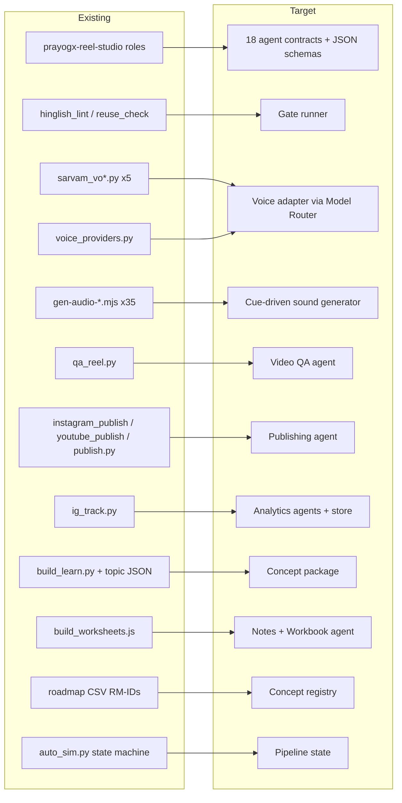

# 01 — Existing System Audit (PrayogX 2.0)

Status: **audit only, nothing changed.** Written 2026-11-21 for the owner's "PrayogX 2.0 — Master Architecture and
Production Quality Audit". Sources: the main repo (`~/Documents/Project simulation`) and the motion studio
(`~/Documents/motion-design-studio/motion-studio`), read in place. Figures were measured on 2026-11-21 unless stated.

Classification key: **RETAIN** (keep unchanged) · **IMPROVE** (same role, better) · **EXTEND** (add capability) ·
**REPLACE** (only where clearly superior) · **NEW** (does not exist).

## 1. Snapshot

| Area | What exists (measured) |
|---|---|
| Simulations | 50 curated JEE Adv 2026 pages (33 Chem, 17 Phys), plus 30 Learn simulations marked REQUIRED |
| Tests | 50+ `verify_*.py` (independent routes) and `sim_*.js` (Playwright), `runall.sh`, visual gates A–K, Learn tests, publisher tests |
| Reel tooling (sim reels) | `tools/reel-maker/` — record sim → compose → original music (`music.py`) → encode → 30 checks → READY_FOR_REVIEW |
| Explainer reels | Motion studio: Remotion 4.0.534 + React 19 + three.js; **157 `src/` folders, 162 `jobs/`, ~10 GB of jobs** |
| Voice | Sarvam (`sarvam_vo*.py`, bulbul, `anand_hi_news` in Bible jobs), STT alignment (`align-voice.py`), levelling (`level-voice.py`); voice layer + provider adapters in reel-maker (`voice.py`, `voice_providers.py`, `voice_verify.py`) |
| Publishing | `instagram_publish.py` (state machine, hash-bound approval), `youtube_publish.py` (OAuth PKCE, private-first), `publish.py` front door, `studio_reel.py` importer |
| Learn | `data/learn/curriculum.json` + **106 topic JSONs**, `build_learn.py`, 106 `notes.pdf`, 68 `worksheet.pdf` |
| Tracking | `tracker_sheet.py` (Sheet upsert via connector), `cbse_tracker.py`, roadmap CSV/JSON (`cbse-series/roadmap`), Reels Log sheet |
| Analytics | `scripts/ig_track.py` (read-only IG Graph snapshots). **Last snapshot 2026-11-05**; no YouTube or website analytics pipeline |
| Skills | 8 project skills; `prayogx-reel-studio` with 9 role files, 5 workflows, 6 templates, 2 lint tools |

## 2. Key findings

1. **The Reel Studio standard is barely in the jobs yet.** Of 162 jobs: `script.md` 143, `review.md` 77,
   `production-plan.md` 22, `research.md` 17, `creative.md` 13, `sound-plan.md` 13, **`visual-design.md` 2**
   (`lanthanoid-contraction`, `starship-catch`). The newest job (`chem-reactions-intro`) has none of the Studio's
   stage files. The 2026-11-17 fixes are documented but not yet the operating reality.
2. **The roles are prompts, not agents.** The nine Studio role files are checklists that one Claude session plays in
   turn. Only QA is (meant to be) independent. There are no input/output schemas, so a stage's output cannot be
   checked by a machine before the next stage starts.
3. **No single concept ID.** One topic carries five identifiers: roadmap `RM-12-CHE-08-0xx`, studio slug
   `aldol-condensation`, reel `STUDIO-ALDOL-CONDENSATION`, Learn `LEARN-C12-CHE-ALDOL`, tracker row. Facts are
   re-typed into script, notes, quiz, workbook and caption separately, so terminology drifts.
4. **Deliverable rules have outrun the data.** Owner rule (2026-11-15): quiz = 10, workbook = 25. Measured quiz
   sizes across 106 topics: 3 (27), 4 (27), 5 (42), **10 (10)**. Workbooks exist for 68 of 106. Memory cards are on
   the Learn page for about one topic.
5. **Script-per-reel sprawl.** 35 `gen-audio-*.mjs`, 5 `sarvam_vo*.py` variants, 25 `session-helpers`. Each new job
   tends to fork a helper. This is the infrastructure twin of the template reuse the audit forbade.
6. **Analytics is manual and stale.** Instagram numbers (2026-11-05, 102 reels): median views 1,280, mean average
   watch time 12.0 s; memory notes watch share falling 28% → 15%. Nothing pulls YouTube Analytics or site analytics,
   and nothing feeds results back into topic choice or hooks.
7. **Small inconsistencies in the Studio skill** (to fix in a later, approved pass): `SKILL.md` §4 says "waves of at
   most three" while `batch-production.md` and the audit say two; `animation-director.md` and the scorecard still
   mention the AI teacher avatar, which the owner retired for new reels on 2026-11-17.
8. **Strong foundations worth protecting:** hash-bound approval, private-first YouTube, original-only music with
   provenance, BS.1770 loudness checks, `qa_reel.py`, the Hinglish lint, the reuse check, secrets in git-ignored
   `.env` in both repos (checked), and the drift gate for generated files.

## 3. Component classification

### 3.1 Main repo

| Component | Class | Note |
|---|---|---|
| Simulation invariants, `SIMULATION_STANDARDS.md`, 50 pages | RETAIN | Frozen by owner rule |
| `prayogx-new-simulation`, `-validate`, `-register`, `-review-existing`, `-chemistry`, `-design-system` | RETAIN | Reused by the Simulation Developer agent |
| `prayogx-auto-simulation` + `auto_sim.py` | RETAIN / EXTEND | Its stage-state machine is the model for the reel pipeline state (doc 02) |
| `prayogx-reel-studio` SKILL + role files | EXTEND | Becomes the agent contracts in doc 03; add schemas, fix the two inconsistencies |
| `AUDIT-2026-11-17.md` | RETAIN | Historical record; its seven changes become measurable gates |
| `hinglish_lint.py`, `reuse_check.py` | RETAIN / EXTEND | Wire into the pipeline runner; reuse check could also cover helper scripts |
| `tools/reel-maker/` (sim reels, 30 checks, `music.py`, `audio.py`) | RETAIN | Sim-capture is one renderer; `audio.py` is reused by `qa_reel.py` |
| `voice.py`, `voice_providers.py`, `voice_verify.py`, `narration.py` | EXTEND | Already a provider contract (estimate / balance / generate); add Sarvam + Gemini-TTS adapters → the voice leg of the router |
| `instagram_publish.py`, `youtube_publish.py`, `publish.py`, `studio_reel.py` | RETAIN | Gates are correct; only called by the Publishing agent |
| `tracker_sheet.py` | RETAIN | Pattern (plan → write via connector → verify) reused for the analytics sheet |
| `build_learn.py`, `data/learn/*` | EXTEND | Reads from the content package instead of hand-written topic JSON |
| `build_worksheets.js`, `worksheets_from_source.py` | IMPROVE | Generate the 25-item workbook from the package's question bank |
| `visual_assets.py` + `visual_library.json` | EXTEND | Becomes the provenance registry for AI images too |
| `production_audit.py`, `check_library.py`, drift gate | RETAIN | |
| `.env` / `.env.example` | RETAIN, later IMPROVE | Move to Secret Manager or macOS Keychain only if cloud runners arrive (doc 07) |
| Analytics | NEW | Instagram, YouTube, website agents (doc 03) |
| Concept registry / content package | NEW | Doc 06 |
| Model router | NEW | Doc 02 §4 |

### 3.2 Motion studio

| Component | Class | Note |
|---|---|---|
| Remotion project, `bible-kit`, `cbse-common` | RETAIN | Shared infrastructure, allowed by the reuse rule |
| `VIDEO_STYLE_GUIDE.md`, `STORYBOARD_TEMPLATE.md` | RETAIN | The visual standard |
| `src/<slug>/` scene code | RETAIN (per job) | Written fresh per reel; no change |
| `jobs/<slug>/` folders | EXTEND | Add `package.json` pointer to the concept package; stage files become schema-checked |
| `sarvam_vo*.py` (5 variants) | REPLACE with one adapter | One `voice` CLI that takes the script + `pronounce.json`; provider chosen by the router |
| `align-voice.py`, `level-voice.py` | RETAIN | |
| `gen-audio-*.mjs` (35) | IMPROVE | Converge on `gen-audio-reel.mjs` driven by `sound-plan.md` cues; per-reel sound stays original |
| `qa_reel.py`, `contact_sheet.py` | RETAIN / EXTEND | Add hook-window and caption-density measures (doc 05) |
| `release-reel.sh`, `release-encode.swift` | RETAIN | Exact A/V sync is proven |
| `ig_track.py` | EXTEND | Becomes the Instagram Analytics agent's collector, scheduled, writing to the analytics store |
| `cbse_tracker.py`, roadmap scripts, `cbse-series/roadmap` | RETAIN | Roadmap row IDs become the concept-ID seed |
| `session-helpers/` (25) | IMPROVE | Promote the stable ones (cards, carousel, shot, stills) to named tools; retire one-offs |
| Higgsfield AI plates | RETAIN | One image provider among several in the router |

## 4. Existing → target component map

## 5. What must not change

Every gate in CLAUDE.md: owner chooses topics, no commit/push/deploy without approval, human approval before
publishing, YouTube private first, original music only, AI disclosure, frozen simulations, no secrets in files.
The target architecture (doc 02) wraps these gates; it never relaxes them.
