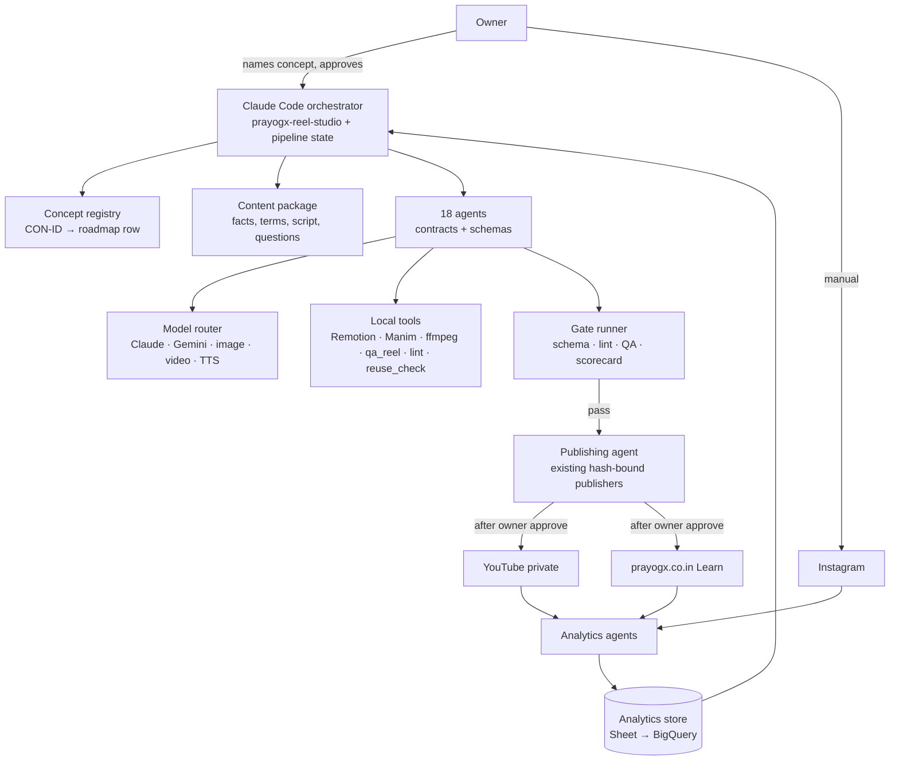

# 02 — Target PrayogX 2.0 Architecture

Status: **design proposal; nothing is built until the owner approves a phase** (doc 08).

## 1. Principles

1. **Claude Code is the orchestrator.** It plans, delegates, checks and reports. Other models are tools it calls
   through the router. Antigravity is a development environment only, never part of production.
2. **One concept ID, one source of truth.** Every artefact is derived from a versioned content package (doc 06).
3. **Agents are contracts.** Each agent has a JSON input and output schema, a gate and an evaluator. A stage that
   does not validate does not hand on.
4. **Gates over goodwill.** The 2026-11-17 lesson: rules that exist only in prose get skipped. Every rule that can
   be measured is a script; the rest goes to an independent reviewer.
5. **Local-first.** Rendering, QA and secrets stay on the Mac. Cloud is added only where it earns its keep
   (analytics warehouse, scheduled collectors). No cloud production backend is needed for Phase 1–3.
6. **Human gates unchanged.** Topic choice, approval, publishing, commit, push and deploy remain the owner's.

## 2. Layers



## 3. Pipeline state

Reuse the `auto_sim.py` pattern: a per-concept state file `jobs/<slug>/state.json` with stages
`REGISTERED → RESEARCHED → HOOKED → SCRIPTED → STORYBOARDED → DESIGNED → ASSETS → VOICED → BUILT → RENDERED →
QA_PASSED → PACKAGED → READY_FOR_REVIEW → APPROVED → PUBLISHED → MEASURED`. A stage is marked done only by
the gate runner, and only in order; resuming re-checks claimed stages against the files. The reel-maker states
(`GENERATED … VERIFIED`) remain the publishing sub-machine.

## 4. Provider-independent model router

A small local Python module (`tools/router/`, proposed) that every agent calls instead of a provider SDK.

### 4.1 Interface

```
route(task: str, payload: dict, budget: Budget, policy: Policy) -> Result
  task ∈ {reason.long, reason.fast, fact.check, math.check, vision.review, image.gen, image.edit,
          video.gen, tts.hinglish, tts.english, stt.align, embed}
  Result = {output, provider, model, cost, latency, attempts, validations[], provenance}
```

### 4.2 Default routing table (to be confirmed by a bake-off, doc 08 Phase 2)

| Task | Primary | Fallback | Validation before accept |
|---|---|---|---|
| reason.long (script, storyboard, research synthesis) | Claude Opus 5.5 (in-session) | Claude Sonnet 5.5 | schema, Hinglish lint, coverage map |
| reason.fast (captions, metadata, rewrites) | Claude Sonnet 5.5 / Haiku 5.5 | Gemini Flash tier | schema, length, banned words |
| fact.check (second opinion) | Gemini Pro tier with Search grounding | Claude with web search | ≥ 2 independent routes agree; else stop |
| math.check | Python (sympy / numpy) | — (models never sole judge) | exact equality / tolerance |
| vision.review (frames vs storyboard) | Claude (independent subagent) | Gemini Pro (video understanding) | evidence per check |
| image.gen / image.edit | Nano Banana (Gemini image) or Higgsfield | the other one | visual-design sheet match, text-free unless asked, provenance logged |
| video.gen (rare plates) | Veo 3.1 Fast via Gemini API | Higgsfield video | owner OK per spend; science check; never the teaching shot |
| tts.hinglish | Sarvam (current voice) | Gemini-TTS hi-IN | STT word match ≥ 98 %, pronounce.json terms, loudness |
| tts.english | Gemini-TTS or Cloud TTS Chirp 3 HD | Sarvam en-IN | same |
| stt.align | Sarvam STT (current) | whisper.cpp (local, already in `.env.example`) | word timings monotonic, coverage |

### 4.3 Controls

- **Budgets:** per call, per concept and per month caps in a local `router.policy.json` (no secrets in it).
  Paid generation above zero needs an owner-approved cap, as the existing voice rule already requires.
  `estimate()` before `generate()` (the `voice_providers.py` contract, generalised).
- **Retries:** at most 2 on transient errors (timeout, 429, 5xx) with backoff; **never** retry a content failure
  blindly — a failed validation goes back to the agent with the reason. Paid generations are not auto-retried
  more than once.
- **Fallback:** on provider outage or quota exhaustion, switch to the fallback and record it; a fallback voice
  never mixes inside one reel (whole reel re-voiced or none).
- **Caching:** hash of (task, model, payload) → result, so re-runs cost nothing.
- **Provenance:** every generated asset gets a row in `visual_library.json` / `audio_library.json` style
  registries (provider, model, prompt hash, licence, date).
- **Logging:** cost and latency per call to `jobs/<slug>/router-log.jsonl`; keys never logged.

## 5. Storage

| Data | Where | Why |
|---|---|---|
| Content packages, state, stage files | git (main repo `content-packages/` or studio `jobs/`) | reviewable, diffable |
| Renders, voice, plates | motion studio `jobs/` (git-ignored large files), archived to external disk | 10 GB already |
| Analytics | Google Sheet now; BigQuery sandbox when > 1 source | doc 04 |
| Secrets | `.env` (git-ignored) now; Keychain / Secret Manager only if cloud jobs arrive | doc 07 |

## 6. Risks and migration strategy

| Risk | Mitigation |
|---|---|
| Architecture becomes bureaucracy that slows reels | Phase 1 adds only the package + gate runner; each later phase must show a scorecard gain |
| Breaking published pages or publishers | Publishers and simulations untouched; new code wraps them |
| Provider churn (model IDs change monthly) | Router table in one file; bake-off before switching |
| Cost creep from generative video | Off by default; per-concept cap; owner OK |
| Two repos drift | The content package lives in the main repo; studio jobs point to it by ID |

**Migration:** strangler pattern. New concepts use the package from Phase 1; old jobs are never migrated
(owner rule: existing work frozen). Learn topics are converted only when the owner asks for that topic.
