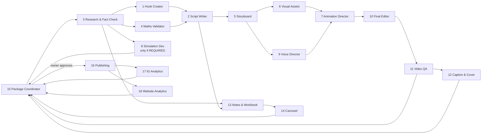

# 03 — Agent Specifications (18 agents)

Status: **design; no agent or skill file has been changed.** An "agent" here is a contract that Claude Code (or a
subagent it starts) fulfils. Most extend an existing Reel Studio role file rather than duplicate it.

## 1. Map to what exists

| # | Owner's agent | Existing role / tool | Verdict |
|---|---|---|---|
| 1 | Hook Creator | part of `scriptwriter.md` + `creative-director.md` | **NEW role, split out** (hooks are the main retention lever, doc 05) |
| 2 | Script Writer | `scriptwriter.md`, `hinglish_lint.py` | EXTEND |
| 3 | Science Research & Fact Checker | `research-director.md`, `research-protocol.md` | EXTEND (add second-model check) |
| 4 | Maths Validator | `verify_*.py` pattern (sims only) | NEW for reels |
| 5 | Storyboard Designer | `storyboard-director.md` + `cinematographer.md` | EXTEND (merge camera into it) |
| 6 | Visual Asset Designer | `visual-designer.md`, `visual_assets.py`, Higgsfield | EXTEND |
| 7 | Animation Director | `animation-director.md`, `reuse_check.py` | RETAIN + schema |
| 8 | Simulation Developer | `prayogx-new-simulation`, Learn `sim.html` + `learn_sims.js` | RETAIN (REQUIRED test only) |
| 9 | Voice Director | `sound-director.md` (narration part), `sarvam_vo*.py`, align/level, `voice_verify.py` | EXTEND (own role) |
| 10 | Final Video Editor | `sound-director.md` (mix), `release-reel.sh` | EXTEND |
| 11 | Video QA | `qa-director.md`, `qa_reel.py`, `quality-gates.md` | EXTEND (scorecard v2) |
| 12 | Caption & Cover Creator | `publish/caption.txt`, `Cover.tsx`, memory rules | NEW role |
| 13 | Notes & Workbook Creator | notes PDFs, `build_worksheets.js` | EXTEND |
| 14 | Instagram Carousel Designer | `chalk_carousel.mjs`, `cards.sh`, `cards_pdf.js` | EXTEND |
| 15 | Content Package Coordinator | none (Claude does it ad hoc) | NEW |
| 16 | Publishing | `publish.py`, IG/YT publishers, `studio_reel.py` | RETAIN |
| 17 | Instagram Analytics | `ig_track.py` | EXTEND |
| 18 | Website Analytics | none | NEW |

The owner's list names 18 titles; "Creative Director" (`creative-director.md`) and "Sound Director" are not in it.
Proposal: the creative director stays the orchestrator's own hat (it chooses the treatment, owns the reuse/diversity
gate); music and effects design moves into the Final Video Editor (#10), narration into the Voice Director (#9).

## 2. Dependency graph

## 3. Common contract (all agents)

- **Input:** `{conceptId, packageVersion, stage, inputs:{…}, constraints:{…}}`; **output:**
  `{conceptId, agent, version, status: pass|fail|blocked, artefacts:[paths], metrics:{…}, issues:[…], provenance:[…]}`
  written to `jobs/<slug>/agents/<agent>.json` beside the human-readable stage file.
- **Failure handling (default):** schema failure → fix and re-emit (max 2); content gate failure → return to the
  upstream agent named in `issues`; science doubt → **stop and report to the owner** (CLAUDE.md "stop and investigate").
- **Evaluation:** each agent is scored on its gate pass rate first time, rework count, and the downstream
  scorecard items it owns (doc 05).
- **Models:** "Claude" means the orchestrating Claude Code session or a subagent; Gemini and others are reached
  only via the router (doc 02 §4).

## 4. Specifications

### 1. Hook Creator — NEW
- **Mission:** stop the scroll in 0–3 s with a hook true to the science.
- **Responsibilities:** 5+ candidate hooks of different types (visual paradox, real observation, wrong-intuition,
  number shock, question); pick one with a reason; storyboard the first 3 s (what is *seen*, not only said);
  check against the last 20 hooks for repetition.
- **Expertise:** short-form retention, Indian student context, science misconceptions.
- **Input:** fact sheet, misconceptions list, last-20 hook log, analytics hook table. **Output:** `hooks.json`
  `{candidates:[{type,line,visual,claimCheck}], chosen, reason, first3s:{frames}}`.
- **Models:** Claude Opus (generation); Gemini Flash as a cheap second brainstorm (optional).
- **Google tools:** YouTube Analytics retention at 3 s (once public data exists).
- **Reuse:** `creative-director.md` diversity check, `reel-standard-opening` memory.
- **Quality standard:** visible change in the first 1 s; no "aaj hum seekhenge"; no clickbait the video does not pay off.
- **Failure:** all candidates near-duplicate a recent hook → regenerate with banned types.
- **Depends on:** 3. **Evaluated by:** 3-s hold rate and watch share vs channel median.

### 2. Script Writer — EXTEND `scriptwriter.md`
- **Mission:** a story-shaped Hinglish narration that teaches the whole coverage map.
- **Responsibilities:** beats from hook to takeaway; every term from the package glossary; `pronounce.json`;
  words-per-second budget per shot; one "aha" line.
- **Input:** fact sheet, coverage map, glossary, chosen hook. **Output:** `script.md` + `script.json`
  `{lines:[{id,text,terms[],factRefs[],targetSec}]}`.
- **Models:** Claude Opus. **Google:** none needed. **Reuse:** `hinglish_lint.py`, script template.
- **Quality:** lint 0 errors; every factual line cites a `factRef`; ≤ 2.6 words/s average (doc 05).
- **Failure:** a line without a `factRef` → back to 3. **Depends on:** 1, 3, 4. **Evaluated:** lint, QA story items.

### 3. Science Research & Fact Checker — EXTEND `research-director.md`
- **Mission:** a cited, NCERT-anchored fact sheet that every other agent trusts.
- **Responsibilities:** NCERT first, wide web research (≥ 8 searches, ≥ 6 sources), coverage map, misconceptions,
  exam points; **independent second check** of every numeric and causal claim by a different route/model.
- **Input:** concept ID, roadmap row, NCERT ref. **Output:** `research.md` + `facts.json`
  `{facts:[{id,statement,value,unit,sources[],checkedBy[]}], coverage:[…], glossary:[…], misconceptions:[…]}`.
- **Models:** Claude (lead); Gemini Pro with Google Search grounding as the second checker.
- **Google tools:** Gemini API grounding; NotebookLM (consumer UI) optional for the owner's own reading.
- **Quality:** every fact two sources or one NCERT + one independent; disagreements resolved or escalated.
- **Failure:** sources disagree → stop, report. **Depends on:** 15. **Evaluated:** QA check 1 errors found later = 0.

### 4. Maths Validator — NEW
- **Mission:** no numerical, unit or equation error reaches the screen.
- **Responsibilities:** recompute every number; balance every chemical equation (atoms + charge); dimensional
  check; check graph shapes against the function; check notes/workbook answer keys.
- **Input:** `facts.json`, `script.json`, equations list, question bank. **Output:** `maths.json`
  `{checks:[{ref,expr,expected,computed,pass}]}` + a small `verify_<slug>.py`.
- **Models:** Python first (sympy, a formula balancer); a model only explains, never judges.
- **Reuse:** `tests/verify_*.py` "two independent routes" pattern. **Quality:** 100 % pass.
- **Failure:** any mismatch blocks script and package. **Depends on:** 3. **Evaluated:** errors escaped to QA/owner.

### 5. Storyboard Designer — EXTEND `storyboard-director.md` (+ `cinematographer.md`)
- **Mission:** shot-by-shot plan where each shot has one dominant action on its spoken word.
- **Input:** script.json, visual grammar, last-5 grammar sheet. **Output:** `production-plan.md` + `storyboard.json`
  `{shots:[{id,lineIds,dominantAction,camera,objects[],reactionShot?,durationSec}]}`.
- **Models:** Claude Opus; optional Nano Banana thumbnails for key frames (cheap animatic).
- **Quality:** reaction shot for every named reaction; no shot static > 2 s; ≥ 5 of 8 grammar axes new.
- **Failure:** fails diversity → back to treatment. **Depends on:** 2. **Evaluated:** QA checks 3, 8, 9.

### 6. Visual Asset Designer — EXTEND `visual-designer.md`
- **Mission:** every object looks like the real one; AI plates only where they add realism.
- **Responsibilities:** object sheet with references; molecule geometry/CPK; real colours; generate or draw assets;
  provenance.
- **Input:** storyboard.json objects. **Output:** `visual-design.md` + `assets.json`
  `{objects:[{name,reference,proportions,colours,source:drawn|generated|stock,provenance}]}`.
- **Models:** Nano Banana (image) / Higgsfield; Claude vision to compare against references.
- **Google tools:** Gemini image API. **Reuse:** `visual_assets.py`, `visual_library.json`, stock-media memory rule.
- **Quality:** no generic stand-ins; no AI text in plates; licences recorded. **Failure:** an object fails
  the reference check → redraw. **Depends on:** 5. **Evaluated:** QA check 4.

### 7. Animation Director — RETAIN `animation-director.md`
- **Mission:** cause → process → effect motion in fresh scene code.
- **Input:** storyboard.json, assets.json, voice timings. **Output:** `src/<slug>/`, `qa/objects.jpg`, stills.
- **Models:** Claude (code); Manim / three.js as tools. **Reuse:** `bible-kit`, `cbse-common`, `reuse_check.py`.
- **Quality:** reuse check pass; benchmark parity (pH, Mole). **Failure:** stills unreadable → redraw before render.
- **Depends on:** 6, 9. **Evaluated:** QA checks 5, 9.

### 8. Simulation Developer — RETAIN existing skills
- **Mission:** a Learn simulation only when the REQUIRED test says so.
- **Input:** facts.json, the REQUIRED reason. **Output:** `learn/<slug>/sim.html` + test.
- **Models:** Claude. **Reuse:** `prayogx-new-simulation` invariants, `tests/learn_sims.js`.
- **Quality:** the simulation invariants in CLAUDE.md. **Depends on:** 3. **Evaluated:** test pass, owner use.

### 9. Voice Director — EXTEND (narration out of `sound-director.md`)
- **Mission:** a natural, correctly pronounced Hinglish voice in sync with the shots.
- **Responsibilities:** spoken form from script; voice generation via router; STT verification; alignment;
  levelling; per-shot timing report.
- **Input:** script.json, pronounce.json, shot durations. **Output:** `voice/records.json`, `align.json`, `level.json`.
- **Models:** Sarvam (primary Hinglish), Gemini-TTS (fallback / bake-off), Sarvam STT or whisper.cpp.
- **Google tools:** Gemini-TTS, Cloud TTS. **Reuse:** `align-voice.py`, `level-voice.py`, `voice_verify.py`.
- **Quality:** STT word match ≥ 98 %, no translated terms (Sarvam may translate, see `reel-cue-gotchas`),
  speech rate within budget. **Failure:** mis-voiced term → fix `pronounce.json`, regenerate that line only.
- **Depends on:** 2, 5. **Evaluated:** QA check 6, owner listening notes.

### 10. Final Video Editor — EXTEND
- **Mission:** pacing, sound design, music and the release encode.
- **Input:** composition, sound-plan, voice. **Output:** release MP4, thumbnail, `audio-report.txt`.
- **Models:** none generative (original music via `gen-audio-reel.mjs` / `music.py`). **Reuse:** `release-reel.sh`,
  `mp4tools.py`, `qa_reel.py`. **Quality:** −1 dBTP, voice 10–20 LU over music, no dead air > 1 s, exact sync.
- **Depends on:** 7, 9. **Evaluated:** automated checks, QA check 9.

### 11. Video QA — EXTEND `qa-director.md`
- **Mission:** independent judgement on the actual render.
- **Input:** contact sheets (≥ 1 fps), research, script, design, lint/reuse/qa outputs, benchmarks. **Output:**
  `review.md` + `qa.json` (ten checks with frame evidence, Scorecard v2 in doc 05).
- **Models:** fresh Claude subagent (required); Gemini Pro video understanding as an optional second reviewer of
  the MP4 itself (it can watch motion and hear audio, which Claude cannot).
- **Quality:** ≥ 90, all ten checks yes. **Failure:** list → upstream agents → re-render → re-review.
- **Depends on:** 10. **Evaluated:** agreement with owner verdicts (calibration log).

### 12. Caption & Cover Creator — NEW
- **Mission:** a cover and caption that earn the tap and match the video.
- **Responsibilities:** cover (subject only, never class), IG caption (3–4 English lines, 5 hashtags, no AI mention),
  YouTube title/description (AI disclosure line), tags.
- **Input:** package glossary, hook, best frame. **Output:** `publish/caption.txt`, `cover.jpg`, `youtube.json`.
- **Models:** Claude Sonnet/Haiku; Nano Banana for cover background only if needed.
- **Quality:** owner caption rules in memory; text readable at 200 px wide. **Depends on:** 11.

### 13. Notes & Workbook Creator — EXTEND
- **Mission:** self-sufficient student notes, 10-question quiz, 25-question workbook, answer keys.
- **Input:** facts.json, coverage, question bank. **Output:** notes PDF + Doc, `quiz.json` (10), `workbook.json` (25),
  `worksheet.pdf`.
- **Models:** Claude; Maths Validator checks every key. **Google:** Docs/Drive API ("Short Notes" folder).
- **Reuse:** `build_worksheets.js`, `worksheets_from_source.py`, notes templates.
- **Quality:** counts exact; every answer validated; YouTube URL in notes only. **Depends on:** 3, 4.

### 14. Instagram Carousel Designer — EXTEND
- **Mission:** a save-worthy 4:5 carousel and memory cards from the same facts.
- **Output:** JPG slides, cards PDF. **Reuse:** `chalk_carousel.mjs`, `cards.sh`, `cards_pdf.js`.
- **Quality:** SAVE + COMMENT + FOLLOW CTA and "Class 12 · CBSE · JEE · NEET" (carousel rule). **Depends on:** 13.

### 15. Content Package Coordinator — NEW
- **Mission:** own the concept package, versions and completeness (doc 06).
- **Responsibilities:** create the package from the roadmap row; lock the glossary; check every artefact quotes
  the package; produce the release checklist; never publish.
- **Models:** Claude (orchestrator). **Reuse:** `auto_sim.py` state machine, `build_learn.py --check`.
- **Quality:** terminology diff = 0 across artefacts. **Failure:** a drift → regenerate that artefact.

### 16. Publishing — RETAIN
- **Mission:** run the existing approval-gated publishers exactly as now.
- **Input:** an APPROVED reel (owner ran `approve`). **Output:** verified URLs, ledger rows, Reels Log row.
- **Reuse:** `publish.py`, `studio_reel.py`, `instagram_publish.py`, `youtube_publish.py`.
- **Rules:** never approve; private YouTube unless told; Instagram by the owner (YouTube-only memory).

### 17. Instagram Analytics — EXTEND `ig_track.py`
- **Mission:** weekly read-only numbers per reel, joined to its concept ID and production features.
- **Output:** rows `{conceptId, views, reach, avgWatchSec, watchShare, saves, shares, follows}` to the analytics sheet.
- **APIs:** Instagram Graph (read-only). **Quality:** snapshot ≤ 7 days old; never stores tokens.
- **Also:** YouTube Analytics API (retention, `audienceWatchRatio`) once Shorts are public.

### 18. Website Analytics — NEW
- **Mission:** which Learn pages, simulations and PDFs students actually use.
- **APIs:** no analytics tag was found in `index.html` or `learn/index.html` (checked 2026-11-21), so today there is
  nothing to read. Options: GA4 + GA4 Data API, or Search Console API alone (no page tag needed, gives search
  queries and clicks per URL). **Output:** weekly table per concept ID.
- **Constraint:** any new tag on prayogx.co.in is a deploy and needs owner approval; check AdSense policy.
