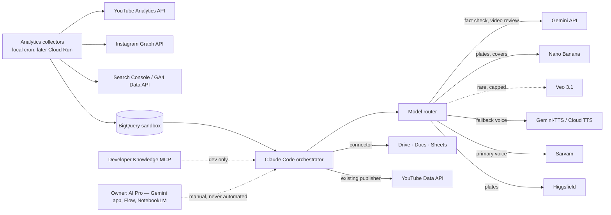

# 04 — Google Ecosystem Mapping

Status: research 2026-11-21. **Prices and model IDs change often; every figure marked (3p) comes from third-party
reporting and must be checked on Google's pricing page before budgeting.**

## 0. The rule that matters most: subscription ≠ API

| | **Google AI Pro (consumer subscription)** | **Gemini API / Vertex AI (developer)** |
|---|---|---|
| What you get | Gemini app, higher usage limits, Flow + Whisk with monthly AI credits (1,000/month reported), NotebookLM higher limits, 2 TB storage | Programmatic access to Gemini, Nano Banana, Veo, TTS, embeddings |
| How you use it | browser / phone UI, by a person | API key or service account, from code |
| Billing | flat monthly (₹1,950/month in India reported (3p); AI Plus ₹399) | pay-as-you-go on a Cloud billing account; some models have a free tier, **Veo and Nano Banana Pro do not** |
| Automatable by Claude Code | **No** (UI only; driving it by browser automation breaks the "no browser automation" security rule) | **Yes** |
| API credits included | **Do not assume any.** One blog reports a small monthly Cloud credit for Pro; not confirmed on Google's pages. Treat as zero. | — |

Conclusion: AI Pro is useful for the **owner's** own exploration (Flow storyboards, NotebookLM reading, Gemini app).
Anything in the pipeline needs a **separate** Gemini API or Vertex project with billing, a budget alert and its own key.

## 1. Service-by-service

Legend — Auto: automatable by API · MCP: an MCP server exists · UI: consumer UI only · Diff: implementation difficulty (L/M/H).

| Service | What it can do for PrayogX | Agents | Auto | MCP | UI only | In AI Pro | API & billing | Limits / notes | India | Diff |
|---|---|---|---|---|---|---|---|---|---|---|
| **Gemini API** (Pro / Flash tiers) | second-opinion fact check with Search grounding, long-context reading of NCERT chapters, video understanding of renders, cheap metadata | 3, 11, 12, 1 | Yes | Via SDK; no official general MCP needed | No | No | API key, billing for paid tier; free tier on some Flash models with rate limits and data-use terms | model IDs change; free-tier data may be used to improve products — use paid tier for unpublished content | Yes | L |
| **AI Studio** | prompt prototyping, key creation, quick TTS/voice auditions | owner, 9 | Partly (exports code) | No | Mostly UI | No (free) | free UI; usage billed to the key's project when paid | — | Yes | L |
| **Nano Banana** (Gemini image; Pro = `gemini-3-pro-image`) | object plates, cover backgrounds, image edits keeping a reference, storyboard thumbnails | 6, 5, 12 | Yes | No | No | In app with limits | ~US$0.134 per 1K/2K image, ~US$0.24 per 4K (3p); no free tier for Pro | AI text in images unreliable for chemistry; SynthID watermark | Yes | L |
| **Veo 3.1** (Fast / Lite / Standard) | rare realistic plates (lab pour, factory, nature) behind 2.5D teaching layers | 6, 7 | Yes (Gemini API / Vertex) | No | No | Via Flow credits only | per second of output: Fast ~$0.10–0.12/s, Standard ~$0.40/s, Lite lower (3p); 4–8 s clips | always generates audio on Gemini API; science accuracy poor for mechanisms; costly | Yes (API); Flow country list not confirmed | M |
| **Flow** | owner's visual exploration, mood boards, animatics | owner | **No official API** | No | **Yes** | 1,000 credits/month (3p) | subscription credits | third-party "Flow APIs" drive a user's account — **not allowed** (unofficial, credential risk) | not all countries | — |
| **Gemini-TTS** (`gemini-2.5-flash-tts`, Pro TTS) | steerable voice by prompt ("warm teacher, slight excitement"), multi-speaker, hi-IN GA, en-IN | 9 | Yes (Gemini API or Cloud TTS) | No | No | No | token-priced; Pro TTS ~$1 in / $20 out per 1M tokens; Flash-Lite TTS ~$0.50 / $10 (Google page) | **Hinglish code-mixing not documented**; needs a bake-off | Yes | L |
| **Cloud TTS (Chirp 3 HD)** | stable studio voices, SSML, en-IN / hi-IN | 9 | Yes | No | No | No | ~US$30 per 1M characters (Google page) | less expressive than Gemini-TTS; SSML control | Yes | L |
| **Developer Knowledge MCP** | Claude Code can search current Google developer docs when building integrations | dev only | Yes | **Yes** (`developerknowledge.googleapis.com/mcp`, preview) | No | No | API key in header | preview; docs only, not content | Yes | L |
| **Firebase MCP** | only if PrayogX later adds Firestore / Auth / Hosting | dev only | Yes | **Yes** (firebase-tools) | No | No | Spark free / Blaze pay-as-you-go | can create projects — keep it off until a Firebase project is approved | Yes | L |
| **Antigravity** | Google's agentic IDE; optional place for the owner to edit code | dev env only | n/a | hosts MCP | IDE | No | free preview tiers | **not part of production**; Claude Code remains orchestrator | Yes | — |
| **Vertex AI** | same models with enterprise controls, regions (Mumbai `asia-south1`), quotas, no training on data | 3, 6, 9 (later) | Yes | No | No | No | service account + billing | more setup than Gemini API; better for data governance | Yes | M |
| **Cloud Run** | scheduled collectors (analytics), a future router service | 17, 18 | Yes | via gcloud | No | No | free tier then per use | not needed for local rendering | Yes | M |
| **Cloud Storage** | archive of renders (10 GB+), media host replacement for the failing Pages media repo | 16, 10 | Yes | No | No | No | ~per GB-month; egress costs | needs public-object policy only for the IG fetch window | Yes | L |
| **Firestore** | concept registry if multiple machines/people edit | 15 | Yes | Firebase MCP | No | No | free quota then per op | **not needed now**; git JSON is simpler and reviewable | Yes | M |
| **Pub/Sub** | event bus between cloud stages | — | Yes | No | No | No | per message | **not needed** at current scale | Yes | M |
| **Secret Manager** | keys for any cloud job | all cloud jobs | Yes | No | No | No | tiny per secret | local `.env` stays fine for local runs | Yes | L |
| **GA4 + Data API** | page, sim and PDF usage per concept | 18 | Yes | community MCPs only | No | No | free (standard) | needs a site tag → deploy + owner approval; consent banner considerations | Yes | M |
| **BigQuery** | one warehouse joining IG, YouTube, GA4, production features | 17, 18, 15 | Yes | community / Google MCP toolbox | No | No | sandbox free (10 GiB, 60-day table expiry, no streaming); GA4 export free up to 1M events/day | sandbox expiry needs care | Yes | M |
| **YouTube Data API v3** | upload (already used), metadata | 16 | Yes (in use) | No | No | No | free quota (upload ~1,600 units) | unaudited project → private-only uploads (known) | Yes | done |
| **YouTube Analytics API** | retention curves, `audienceWatchRatio`, traffic source, subscribers per Short | 17, 1 | Yes | No | No | No | free | needs `yt-analytics.readonly` scope; data meaningful only once Shorts are public | Yes | L |
| **Workspace APIs** (Docs, Drive, Sheets, Slides) | notes Docs in "Short Notes", tracker and Reels Log, analytics sheet | 13, 15, 17 | Yes | **connectors already attached in this app** (Drive, Sheets) | No | Drive storage | free within quotas | — | Yes | L (in use) |
| **NotebookLM** | owner/research reading of NCERT + sources; audio overview for self-study | 3 (human-assisted) | Consumer: **No**. Enterprise API: yes (v1alpha) | No | consumer yes | higher limits in AI Pro | Enterprise API needs Gemini Enterprise licence | alpha; not worth it for the pipeline | Yes | H |

## 1b. Hinglish voice: Sarvam vs Google

| Criterion | Sarvam (current, bulbul + `anand_hi_news`) | Gemini-TTS | Cloud TTS Chirp 3 HD |
|---|---|---|---|
| Code-mixed Hinglish (Latin English terms inside Hindi) | built for Indian code-mixing; proven on PrayogX reels | hi-IN GA, but code-mixing not documented | per-locale voices; mixing weaker |
| Style control | speaker + pace | **natural-language style prompt**, multi-speaker | SSML only |
| Known PrayogX issues | sometimes translates English words (mango → aam), needs `pronounce.json` | untested | untested |
| STT for alignment | Sarvam saaras (in use) | Gemini / Cloud STT | Cloud STT |
| Data residency | India company | US/global (Vertex region options) | same |

**Verdict:** keep Sarvam as primary. Run a blind bake-off (doc 08, Phase 2): the same three scripts on Sarvam,
Gemini-TTS Flash and Pro, scored by the owner for naturalness and by STT for term accuracy. Switch only if Google
wins clearly; otherwise Gemini-TTS is the fallback when Sarvam is down.

## 2. Integration diagram

## 3. Recommendation (in order of value)

1. **Gemini API key on a new, billed project with a ₹ budget alert** — enables the second-opinion fact checker,
   Gemini video review of renders, and a TTS bake-off. Low cost, high value.
2. **YouTube Analytics API scope** on the existing OAuth client — retention data is the missing feedback loop.
3. **Nano Banana** behind the router as the second image provider (Higgsfield stays).
4. **BigQuery sandbox** only when two analytics sources are flowing; a Sheet is enough first.
5. **Veo**: keep off; allow per-concept with an explicit owner cap for one or two realism plates.
6. Skip Firestore, Pub/Sub, Cloud Run, NotebookLM Enterprise and Firebase for now.

## Sources

- [Google AI Pro features, limits (3p)](https://aiera.blog/google-ai-pro-in-2026-price-features-limits-a/) ·
  [Pro credits (3p)](https://whizi.io/resources/what-is-google-ai-pro/) · [Veo 3 pricing (3p)](https://www.cloudzero.com/blog/veo-3-pricing/)
- [Google AI Plus in India (Google blog)](https://blog.google/intl/en-in/company-news/technology/do-more-with-ai-for-less-google-ai-plus-now-in-india/) ·
  [Gizbot Plus vs Pro, ₹1,950](https://www.gizbot.com/artificial-intelligence/google-ai-plus-plan-launched-in-india-find-out-how-it-compare-to-google-s-ai-pro-plan-121511.html)
- [Gemini-TTS docs](https://cloud.google.com/text-to-speech/docs/gemini-tts) · [Cloud TTS pricing](https://cloud.google.com/text-to-speech/pricing)
- [Veo 3.1 pricing forum thread](https://discuss.ai.google.dev/t/the-documentation-for-veo-3-1-using-table-is-incostient-with-what-is-shown-on-the-generative-ai-page/145253) ·
  [Veo in Gemini API (Google)](https://developers.googleblog.com/es/veo-3-now-available-gemini-api/) · [Flow FAQ](https://labs.google/fx/tools/flow/faq)
- [Gemini 3 Pro Image docs](https://docs.cloud.google.com/gemini-enterprise-agent-platform/models/gemini/3-pro-image) ·
  [Nano Banana Pro pricing (3p)](https://magichour.ai/blog/nano-banana-pro-pricing)
- [Developer Knowledge MCP](https://developers.google.com/knowledge/mcp) · [launch post](https://developers.googleblog.com/en/introducing-the-developer-knowledge-api-and-mcp-server)
- [Firebase MCP server](https://firebase.google.com/docs/ai-assistance/mcp-server)
- [NotebookLM Enterprise audio overview API](https://docs.cloud.google.com/gemini/enterprise/notebooklm-enterprise/docs/api-audio-overview)
- [GA4 BigQuery Export](https://support.google.com/analytics/answer/9358801) · [limits guide (3p)](https://www.relevantaudience.com/analytics/ga4-bigquery-export-guide/)
