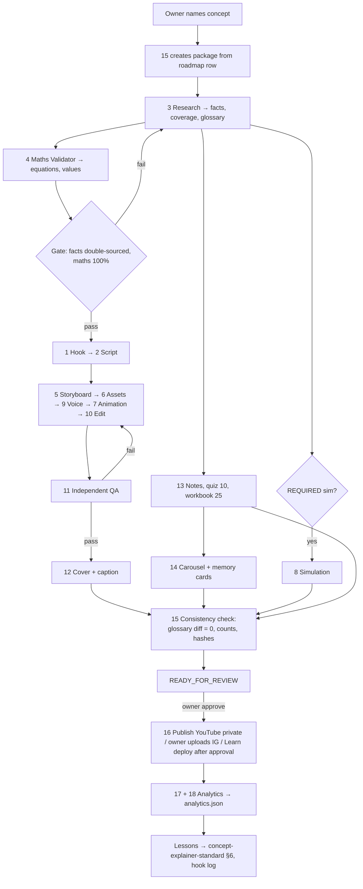

# 06 — Content Package Workflow

Status: design. One concept ID produces every artefact from one source of truth with one vocabulary.

## 1. Concept ID

`CON-<CLASS>-<SUBJ>-<CH>-<NNN>-<SLUG>`, e.g. `CON-12-CHE-08-012-ALDOL-CONDENSATION`, seeded 1:1 from the roadmap
row (`RM-12-CHE-08-012`). Existing IDs stay valid as **aliases** stored in the package (`studioJob`, `reelId`
`STUDIO-…`, Learn `LEARN-…`, tracker row). Note: `CON-<SUBJ>-<SLUG>` already exists in `tools/registry_schema.py`
for concept *simulations*; the format above is a proposal to reconcile with it before any code (owner decision).

## 2. Package layout (proposed, main repo)

```
content-packages/<CON-ID>/
  package.json        id, version, aliases, status, owner decisions, artefact index with sha256
  facts.json          the fact sheet: statements, values, units, sources, checkedBy   ← single source of truth
  glossary.json       locked terms: English term, voice spelling, Hindi glue allowed?, symbol
  coverage.json       NCERT subtopics → in video | notes only (reason)
  questions.json      question bank: ≥ 35 items with answers, difficulty, factRefs (10 → quiz, 25 → workbook)
  equations.json      balanced equations / formulas, validated by the Maths Validator
  script.json         lines with factRefs (from the reel job)
  analytics.json      appended weekly by analytics agents
```

Heavy media stays in the studio job (`jobs/<slug>/`), referenced by hash.

## 3. Artefacts and their sources

| Artefact | Built from | Owner of the step | Check |
|---|---|---|---|
| Reel (complete) | facts, glossary, coverage, script | 1, 2, 5–11 | Scorecard v2 ≥ 90 |
| Instagram short cut (if approved) | same build, a sub-range of shots | 10 | same QA, own hook check |
| Cover | hook, best frame, glossary | 12 | subject only, readable small |
| IG caption, YouTube title/description/tags | glossary, facts | 12 | caption rules; AI disclosure on YouTube |
| Carousel (4:5) + memory cards PDF | facts, equations, glossary | 14 | CTA rule; terms match glossary |
| Notes (Doc + PDF, "Short Notes") | facts, coverage, equations, diagrams | 13 | self-sufficient; YouTube link in notes only |
| Quiz (10) | questions.json | 13 + 4 | exact count; keys validated |
| Workbook (25) | questions.json | 13 + 4 | exact count; keys validated; no URL |
| Simulation | facts (only if REQUIRED) | 8 | simulation invariants + test |
| Learn topic JSON + page | package index | 15 → `build_learn.py` | `build_learn.py --check` |
| Analytics report | analytics.json | 17, 18 | ≤ 7 days old |

## 4. Workflow



## 5. Consistency rules

1. No artefact states a number or equation that is not in `facts.json` / `equations.json`.
2. Every term on screen, in notes, quiz and caption is spelled as in `glossary.json` (automated diff).
3. A change to a fact bumps `package.version`; artefacts built from an older version are flagged stale.
4. Published artefacts are never silently regenerated; a revision follows the existing revision rules.

## 6. Migration

New concepts only. The 106 existing Learn topics keep their JSON; one is converted only when the owner asks
for that topic (frozen-work rule). `build_learn.py` gains a reader for packages next to the old format.
