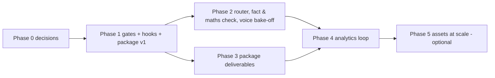

# 08 — Implementation Roadmap

Status: **proposal. Nothing starts until the owner approves a phase.** Each phase ends with a report, a measured
before/after on the scorecard, and the owner's go-ahead before its commit (same pattern as other PrayogX tracks).

## Phase 0 — Decisions (owner, ~1 session)

1. Approve the target architecture and the 18-agent split (doc 03), including folding Creative/Sound roles.
2. Concept ID format vs the existing `CON-<SUBJ>-<SLUG>` (doc 06 §1).
3. Two-length strategy for Instagram: yes / no (doc 05 §3 #4).
4. Create (yourself) a billed Gemini API project with a budget alert — or defer Google APIs.
5. Website analytics: Search Console only, GA4, or none.

## Phase 1 — Make the existing standard real (no new providers) · 1–2 weeks · cost 0

- Pipeline state + gate runner (`jobs/<slug>/state.json`), reusing the `auto_sim.py` pattern: render refuses to start
  without research + coverage, visual-design sheet, lint 0 errors, reuse pass.
- Agent output schemas for agents 1–7, 9–11, 15 (JSON beside each stage file).
- Hook Creator role file + hook log; Scorecard v2 in `quality-gates.md`; calibration log.
- Fix the two Studio inconsistencies (waves of two; avatar retired).
- Content package v1 (facts, glossary, coverage, questions) for the **next concept the owner names** only.
- **Exit:** one reel through the runner, Scorecard v2 ≥ 90 by an independent reviewer, owner verdict recorded.

## Phase 2 — Second opinions and the router · 1–2 weeks · ~US$10–20

- Router module with Claude + Gemini text, budgets, caching, logs.
- Gemini grounded fact-check (agent 3) and Python Maths Validator (agent 4).
- Gemini video review of the MP4 as second QA (agent 11).
- Voice bake-off: Sarvam vs Gemini-TTS Flash/Pro on 3 scripts; owner listens blind. Adapters in `voice_providers.py`.
- Consolidate `sarvam_vo*.py` into one voice CLI.
- **Exit:** fact/maths errors caught before QA; bake-off decision recorded.

## Phase 3 — Package deliverables from one source · 2 weeks · cost ≈ 0

- Notes, quiz (10), workbook (25), carousel and memory cards generated from the package (agents 13, 14).
- Caption & Cover agent (12); glossary consistency diff.
- `build_learn.py` reads packages (old topic JSON still supported).
- **Exit:** one concept's full package with diff = 0 and exact counts; Learn `--check` passes.

## Phase 4 — Feedback loop · 1–2 weeks · free APIs

- Instagram collector scheduled weekly (extend `ig_track.py`); YouTube Analytics scope + collector;
  Search Console (and GA4 only if approved).
- Analytics sheet keyed by concept ID; monthly "what worked" report (hook type, length, topic breadth vs watch share).
- BigQuery sandbox only when ≥ 2 sources flow.
- **Exit:** first monthly report used to choose hooks/lengths.

## Phase 5 — Assets at scale (optional) · as needed

- Nano Banana adapter beside Higgsfield; real-apparatus object library (infrastructure, reviewed once).
- Veo behind an explicit per-concept owner cap, for realism plates only.
- Cloud Storage as media host if the Pages media repo keeps failing (separate approval; touches publishing).

## Prioritised plan (value ÷ effort)

## Risks

| Risk | Mitigation |
|---|---|
| Process overhead slows output further | Phase 1 adds checks that already exist as prose; measure hours per reel before/after |
| Quality does not rise | Each phase must show a scorecard and market-score gain on real reels, or it is rolled back |
| Provider/model churn | router table in one file; bake-offs before switching |
| Spend surprises | caps, alerts, Veo off by default |
| Existing work disturbed | strangler migration; frozen simulations, published reels and Learn topics untouched |
| Owner time as the bottleneck | one approval point per reel (READY_FOR_REVIEW) with a single review page |

## Migration strategy

Strangler pattern: the new runner, package and router apply to **new concepts** from Phase 1. Old jobs, Learn
topics, simulations and publishers keep working unchanged. A legacy item moves to the new format only when the owner
asks for that item. Nothing is deleted or moved.

## Not in scope (unless the owner asks)

Student upload/AI-generation platform, accounts, cloud backend, Firestore/Pub/Sub, NotebookLM Enterprise,
browser-automating consumer apps (Flow, Gemini app), full-3D reels.
