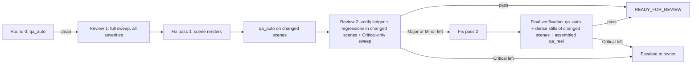

# 10 — Smart QA & Render Optimization: audit and proposal (2026-11-22)

Status: **approved by the owner and built on 2026-11-22** (see §8). It applies to jobs started from 2026-11-22. Scope: new reels made through the Reel Studio (motion studio). Past reels are never re-rendered.

## 1. Short answer

Every QA round is a fresh reviewer, with no memory, looking at a different sample of frames and holding the reel
to a partly subjective bar. The review has no severity levels and no limit on rounds, and every fix triggers a full
render. So each round finds a new set of issues, the score climbs slowly (63 → 70 → 73, 68 → 78), and the loop has
never converged on its own. You ended it by hand on all three recent reels.

| # | Question | Finding |
|---|---|---|
| 1 | Why new issues every round | No issue ledger; a fresh subagent each round; sparse, shifting frame samples; fixes cause regressions; the instruction is to "list every problem" |
| 2 | Subjective / inconsistent criteria | Partly. Checks 5 ("comparable to benchmarks"), 9 ("meaningful and polished") and 10 are judgement calls. The text-size and still-frame rules conflict between files. One stale rule (the avatar) was enforced |
| 3 | Consolidated report | Yes, per round (`qa.json` problems list). But it is not carried forward: round N+1 never sees round N |
| 4 | Critical / major / minor | No. Only "critical failure" or "problem". A 30 px tick label and a made-up number weigh the same in the fix list |
| 5 | Full render for small fixes | Yes, always: `render.sh` renders the whole composition, the thumbnail, the release copy and both `qa_reel` runs |
| 6 | Scene render, caching, reuse | Not used. Remotion supports `--frames` and `--muted`, and `timing.ts` already holds exact scene windows. There is no scene cache and no concat step |
| 7 | Deterministic QA | `qa_reel.py` is deterministic (14 checks). The layout rules (size, clipping, collisions, empty wipes) are judged by eye from stills, so they are not repeatable. `chalk_overlap.mjs` measures them, but only for chalk reels |
| 8 | Round limit | None. The rule is "Loop until the gate is met" |

## 2. Evidence: the last three independent QA loops

| Reel | Rounds | Scores | Outcome |
|---|---|---|---|
| `lanthanoid-contraction` | 3 reviews + a 4th fix render | 63 → 70 → 73 | You stopped the loop and shipped it ("stop and ship anyway", 2026-11-17) |
| `starship-catch-short` | 2 reviews + a 3rd fix render | 68 → 78 | You stopped it ("make it final", 2026-11-22) |
| `lanthanoids-technology` | 1 review + a fix render, after 3 author draft renders | 73 | You stopped it ("no further check", 2026-11-21) |

What the rounds found (from `jobs/*/review.md` and `jobs/lanthanoids-technology/qa.json`):

- **The same categories come back every round.** Text under 40 px, collisions, wipes onto empty frames, a locked
  camera and static holds appear in all three `lanthanoid-contraction` rounds. These are measurable, and none is
  measured before review.
- **Fixes cause new defects.** In `lanthanoid-contraction` round 3 the reviewer caught "Hf ≈ 173?/163?". That
  number came from the round-2 fix: a tween that interpolated the label.
- **Most findings are deterministic.** Of the 20 round-1 problems for `lanthanoids-technology`, 12 can be measured
  by a script:

  | Kind | Timecodes |
  |---|---|
  | Font size | 00:08, 00:41, 00:58, 01:15, 01:49, 01:58 |
  | Edge clipping | 00:30, 00:56 |
  | Overlap | 00:32, 01:30, 01:35 |
  | Static stretch | 00:42 |

  The other 8 are real judgement: object realism, a visible reaction product, the camera vocabulary.
- **The script and the reviewer disagree.** `qa_reel.py` reports a static stretch over 2 s as INFO with
  `pass: True` (lines 81–94). But `quality-gates.md` makes "no still stretch > 2 s" a Scorecard v2 measure, and the
  reviewer listed it as a critical failure. The script says pass and the reviewer then fails the reel, so every round
  can trip on it.
- **A stale rule was enforced.** `lanthanoid-contraction` round 1 listed "AI teacher avatar absent" as critical,
  although the no-avatar rule had just been adopted that day.

## 3. Root causes, with the exact files

| Cause | Where |
|---|---|
| R1. A fresh reviewer each round with no memory of earlier rounds. It re-reviews everything and is told to "list every problem it finds" | `.claude/skills/prayogx-reel-studio/agents/qa-director.md` ("Independent review"), `workflows/single-reel.md` §7 |
| R2. No severity, so every problem blocks. Any "no" on ten broad checks blocks, and one 30 px label turns check 7 to "no" | `workflows/quality-gates.md` §1 and "Critical failures"; `templates/qa-report.md` |
| R3. An unbounded loop: "Loop until the gate is met" | `quality-gates.md` "Improvement loop"; `single-reel.md` §7 |
| R4. Calibration pushes scores down: "A first render is rarely above 85" combined with ≥ 90 to pass, scored from impressions | `qa-director.md` "Calibration"; the scorecard in `quality-gates.md` |
| R5. Measurable rules are left to the eye. Text size, safe area and collisions have no automated check outside chalk; static stretches are reported as INFO | `scripts/qa_reel.py` (lines 81–94); `scripts/session-helpers/chalk_overlap.mjs` is chalk-only |
| R6. Sparse frame samples that differ each round. The reviewer gets a 16-tile contact sheet (1 frame per 3.2 s) plus whatever sheets the author made, so issues in unsampled frames surface later | `scripts/session-helpers/render.sh` (the contact-sheet line); `qa-director.md` says "≥ 1 frame per second" |
| R7. Conflicting thresholds. Text: "≥ 40 px" (gates), "≥ 44 px labels / ≥ 40 axes" (a fix list), "tile numbers ≥ 28". Still frames: INFO in the script, a gate in Scorecard v2 | `quality-gates.md`, `review.md` files, `qa_reel.py` |
| R8. A full render on every fix: the whole composition (`npx remotion render <Comp>`), the thumbnail, the release copy (decode every frame and re-encode, about 6 min), and `qa_reel` twice | `scripts/session-helpers/render.sh`, `jobs/<slug>/release.sh` |
| R9. No regression guard. Fixed issues are not re-tested on the next render, so fixes can silently break other frames | none exists |
| R10. No escalation path. When the loop stalls, the owner steps in ad hoc ("stop and ship") | `quality-gates.md`: "if it cannot be met, stop and tell the owner" (no trigger defined) |

The renderer itself is not the problem. Remotion renders each frame as a pure function of its frame number. Every
2.0 job has exact scene windows in `src/<slug>/timing.ts` (`SCENES[n].from/to`). The audio is a separate
`Soundtrack` layer. So scene-range rendering and reuse are possible without changing how scenes are written.

The old `tools/reel-maker` pipeline (the JEE simulation reels) is not affected. Its 30 checks are deterministic
(`validate.js`, `audio_check.py`) and it has no subjective loop.

## 4. Proposal: the Smart QA & Render system

### 4.1 Severity classes (fixed and written down)

| Severity | Definition | Examples | Blocks approval? |
|---|---|---|---|
| **Critical** | Wrong science, misleading content, a broken render, an owner rule broken | made-up number; unbalanced equation; named reaction not shown; generic stand-in for a key object; mis-voiced key term; clipped meaningful text; black or glitch frames | Yes, always |
| **Major** | Clearly hurts understanding or quality on a phone, and the fix is clear | hero too small for the idea; text 32–39 px; collision with meaningful text; still > 2 s under narration; a wipe onto an empty frame; a reaction with weak visible change | Yes, but only in round 1 and on changed scenes (see 4.5) |
| **Minor** | Polish a casual viewer would not notice | text 40–43 px where 44 was hoped for; a camera move that could be richer; a tag 10 px off | No. Logged in the backlog, fixed if cheap |

The current "Critical failures" list in `quality-gates.md` maps one to one onto Critical. Each of the ten mandatory
checks becomes "no" **only** when a Critical or Major issue is mapped to it. That removes R2 without lowering the
bar for science.

### 4.2 Round 0: deterministic pre-QA (new, about 5 min, before any reviewer)

Add one script, `scripts/qa_auto.mjs <job> <Comp>`. It runs on the bundle (no full render), and its rules come
from one file, `qa_rules.json`, so every threshold has a single source (fixes R7).

| Check | How | Severity |
|---|---|---|
| Text ≥ 40 px, equations ≥ 48 px | Playwright on the bundle at every 0.5 s: each text node's on-screen size after camera scale. The method `chalk_overlap.mjs` already uses | Major (Critical if < 28 px and meaningful) |
| Safe area: nothing within 64 px of an edge | text bounding boxes | Critical (clipped) or Major |
| Text–text and text–object collisions | box intersection, as `chalk_overlap.mjs` does | Major |
| Static stretch > 2 s under narration | the existing `qa_reel.py` measure, promoted from INFO to FAIL outside the declared `holds.json` | Major |
| Wipe onto an empty frame | mean-luma and edge-density drop at each scene boundary in the stills | Major |
| Numbers on screen match the package | text nodes vs `equations.json` / `facts.json` values (catches tween ghosts like "Hf ≈ 173?") | Critical |
| Determinism | no `Math.random()` without a seed, no `Date` in `src/<slug>/` | blocks scene caching |
| Audio and format | `qa_reel.py`, unchanged | as now |

The reviewer only starts when Round 0 is clean. In the `lanthanoids-technology` round 1, that would have cleared
12 of the 20 problems before the reviewer saw the reel.

### 4.3 One consolidated report and a persistent issue ledger

- Each review round writes `jobs/<slug>/qa/round-N.json`: issues with `id`, `severity`, `scene`, `timecode`,
  `check` (1–10), `area`, `evidence`, `fix`. A new schema, `tools/schemas/qa-round.schema.json`. `qa.json` stays
  as the final verdict, so `reel_pipeline.py` keeps working.
- `jobs/<slug>/qa/issues.json` is the ledger across rounds, with statuses
  `open → fixed (author) → verified (QA) | reopened | waived (owner)`.
- The reviewer in round N+1 is still a fresh subagent (independence is kept), but it **is given the ledger**. Its
  first job is to verify each open item, with frame evidence.

### 4.4 Clear pass / fail and a repeatable score

- **Pass:** 0 Critical, 0 Major open, all ten checks "yes", and a score ≥ 90 (your gate, unchanged).
- **The score is computed from the ledger,** not from impressions. Each area starts at its maximum and loses points
  per open issue in that area: Critical −8, Major −3, Minor −0.5, with each area's Minor total capped at −2. The
  reviewer still lists issues by judgement, but the same issues always produce the same score (fixes R4 and makes
  rounds comparable).
- `packages/calibration.json` (already in Scorecard v2) keeps the reviewer honest against your own scores. The
  "rarely above 85" sentence is replaced by this calibration.

### 4.5 At most two correction rounds, and no moving goalposts

What each round may raise:

| Round | Can raise |
|---|---|
| Review 1 | anything, at any severity |
| Review 2 | (a) items not actually fixed; (b) regressions in scenes changed since review 1; (c) a new **Critical** anywhere. A new Major or Minor in an **unchanged, already reviewed** scene goes to the backlog and does not block |
| Final verification | is mostly scripted. It checks that the round-2 items are fixed and nothing regressed. It raises no new review |

Every fixed item that a rule can measure becomes a **regression probe** in `qa_rules.json` for that job (for example
"label `Hf` at 63–65 s shows only `?`, `176?` or `159 pm`"). Round 0 re-runs the probes on every later render. An
issue that is fixed once cannot come back unnoticed (fixes R9).

### 4.6 Scene-level rendering and caching

A new `scripts/session-helpers/render_scenes.sh <job> <Comp> [scenes…]` (the existing `render.sh` stays as it is):

1. Reads `SCENES` from `timing.ts` (it already exists for every new job).
2. Renders each needed scene video-only:
   `npx remotion render <Comp> renders/scenes/s<n>-<key>.mp4 --frames=<from>-<to-1> --muted --codec=h264 --crf=18`.
   `<key>` = a hash of the scene window, `voice.json`, `holds.json`, `src/<slug>/**` and the scene's assets.
3. Decides which scenes are dirty, with two signals:
   - the ledger's fix list, which names the scenes it changes;
   - a cheap **visual diff**: 0.25-scale stills every 0.5 s (`stills.mjs`, one bundle) compared with the previous
     approved stills. This catches shared-code side effects in scenes nobody meant to touch.
   - If a timing change shifts frames (re-voiced line, new hold), every scene after it is re-rendered.
4. Renders the audio once per audio change (`--codec=wav` of the same composition, or the existing bed plus
   `Soundtrack`). Approved audio is reused.
5. Assembles with ffmpeg concat (`-c copy`; all segments use identical encoder settings) and muxes the audio.
6. Verifies the assembly: `qa_reel.py` (frame count = composition, audio spans the video, clips on their slots),
   plus a seam check. One frame on each side of every joint is compared with a direct `renderStill` of the same frame.

Further reuse:

- **The release copy, its QA and the thumbnail run once,** after approval. During QA rounds only the CRF-18
  assembled render is used. That saves about 6 min of release work per extra round (release copy 18:59 → 19:05 on
  `lanthanoids-technology`).
- Approved voice clips, the music bed, `objects.jpg` and the cards are already per-file. They are only regenerated
  when their own inputs change (hash check, same key idea).
- A full render stays available and is used once at the end if any seam check fails, so the fallback is today's path.

### 4.7 Final verification and human escalation

- **Final verification:**
  - Round 0 on the whole assembled video.
  - Dense stills (every 0.25 s) of the changed scenes.
  - `qa_reel.py` on the assembly.
  - The release copy and its QA, once.
  - The independent reviewer signs the ledger: every item is verified, waived or backlog.
- **Escalation to you** happens when any of these is true:
  - a Critical is still open after fix pass 2;
  - the author and the reviewer disagree on a Critical;
  - the score has not improved between review 1 and review 2.

  The studio writes `qa/escalation.md` with the open items, frames and options (fix again, waive, ship as is). It
  stops at READY_FOR_REVIEW with the honest score. This is what you already did by hand three times, now with a
  trigger and a one-page summary.

## 5. Expected time savings (estimates, to be measured on the first pilot reel)

Today, per round on a ~2-minute chemistry reel:

| Step | Time |
|---|---|
| Author fixes | 30–60 min |
| Full render (file times suggest roughly 10–40 min for rich reels; not measured precisely) | 10–40 min |
| Release copy | ~6 min |
| `qa_reel` ×2 and contact sheets | ~3 min |
| Independent review | 10–15 min |
| **Total per round** | **~1–2 h** |

The last three reels took 2–4 rounds and still did not converge.

| Change | Saves |
|---|---|
| Round 0 catches the measurable ~60% before review 1 | one whole review round on most reels (~1–2 h) |
| Ledger + "no new Major in unchanged scenes" + cap of 2 | ends the open-ended rounds 3–4 (~1–3 h on the bad cases) |
| Scene renders in fix pass 2 and final verification (typically 2–6 dirty scenes of 12–30) | 60–85% of render time in those passes |
| Release copy and thumbnail once instead of every round | ~6–8 min × each extra round |
| Fix pass 1 still touches most scenes | little render saving there. Honest: the big win is fewer rounds, not faster renders |

A realistic target: **one review, one fix pass, one verification**, about 2–3 h of QA and render per reel instead
of 3–6 h with no guaranteed end. The science and the ≥ 90 bar are unchanged.

## 6. Implementation plan (after approval; new reels only)

| Step | File | Kind |
|---|---|---|
| 1 | `scripts/qa_rules.json` (thresholds: text 40/48 px, safe area 64 px, still 2 s, deductions) | new |
| 2 | `scripts/qa_auto.mjs` (Round 0; reuses the `chalk_overlap.mjs` approach and the existing `qa_reel.py`) | new |
| 3 | `tools/schemas/qa-round.schema.json`, `issues.json` handling; `reel_pipeline.py` QA_PASSED reads the ledger | new + small change |
| 4 | `scripts/session-helpers/render_scenes.sh` (scene renders, cache keys, concat, seam check) | new; `render.sh` untouched |
| 5 | Skill text: `qa-director.md` (ledger, severities, what each round may raise), `quality-gates.md` (severity table, the computed score, two rounds, escalation; static stretch promoted), `single-reel.md` §6–7, `templates/qa-report.md` | edit |
| 6 | `tests/test_px2.py`: severity scoring, ledger rules, cache keys, a 2-scene render and concat fixture | extend |
| 7 | Pilot on the next new reel. Compare rounds, time and your score with the last three reels | measure |

## 7. Decisions for the owner

1. **Severities:** a Major in an unchanged, already-reviewed scene goes to the backlog and does not block in round 2.
   Is that acceptable?
2. **Score from the ledger** (fixed deductions) instead of an impression score, keeping ≥ 90 and the ten checks?
3. **Two correction rounds,** then escalation to you with `qa/escalation.md`?
4. **Promote "still > 2 s under narration"** from INFO to a Major failure in `qa_auto`, outside the declared holds?

Nothing in the existing Reel Maker, `render.sh`, published reels or the website changes. The approval, publishing,
commit and deploy gates stay exactly as they are.

## 8. What was built (2026-11-22)

The owner approved §7 as proposed.

| Piece | File |
|---|---|
| Thresholds and deductions (the one source) | `tools/qa_rules.json` |
| Round 0 measurement: text size after camera scaling, boxes, opacity; 0.25-scale stills | `<studio>/scripts/session-helpers/qa_auto.mjs` |
| Round 0 rules, issue ledger, review merge, computed score, backlog rule, escalation, waivers | `tools/qa_ledger.py` (`auto`, `review`, `fix`, `changed`, `waive`, `status`) |
| Reviewer's round file | `tools/schemas/qa-round.schema.json` |
| Scene renders, cache, audio reuse, join, frame checks | `tools/scene_render.py` |
| Gate runner: Round 0 must be clean (RENDERED), the ledger's decision must be PASS (QA_PASSED); new jobs only | `tools/reel_pipeline.py` |
| Skill text | `agents/qa-director.md` §Smart QA, `workflows/quality-gates.md` §Smart QA, `workflows/single-reel.md` §6–7, `templates/qa-report.md`, `SKILL.md` §3b |
| Tests (29) | `tests/test_smart_qa.py`, in `tests/runall.sh` |

The wipe-onto-an-empty-frame check stays with the reviewer, because stills every 0.5 s are too sparse to catch a
10-frame wipe. Text–object collisions (text over a drawn shape) are also still judged by the reviewer. Round 0
measures text against text and against the frame edges.

Unchanged: `render.sh`, `release.sh`, `qa_reel.py`, `tools/reel-maker`, every past job, and the approval, publish,
commit and deploy gates.

### Pilot (2026-11-22, `lanthanoids-technology`, output in a scratch folder; the job was not touched)

- **All 12 scenes rendered scene by scene and joined:**
  - 3951 frames, which equals the composition.
  - Compared with the original full render, frames are bit-identical (PSNR ∞) or ≥ 43 dB at segment starts.
  - About 13 min for the 12 scene renders.
- **One scene re-rendered (`--scenes 5`), with 11 reused:**
  - re-render, audio, join and `qa_reel.py` took **4 min 19 s**;
  - `qa_reel` passed 15/15 (14/14 checks in the tool's own tally).
- **The first pilot's own audio re-encode came out at −1.00 dBTP.** The audio now uses Remotion's own AAC, as a full
  render does.
- **Round 0 measurement** (`qa_auto.mjs`) works on the real composition. Each sampled frame lists every visible text
  with its scaled size and box. On the fixed render it flagged the E° axis labels at x = 5 px (safe area), which the
  reviewer had missed.
